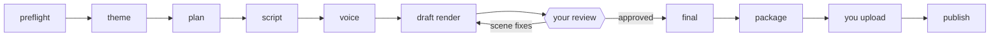

# The pipeline

State for each video lives in `draft_videos/<slug>/state.json`, managed only through `state.py`. Steps: `preflight, topic, plan, script, voice, draft, review, final, package`. Every step is resumable; `/aurora resume` continues from the first pending one and never redoes finished work.

| Step | Who | Output |
|---|---|---|
| 0 Preflight | main chat | `./video-kit` ready, `run_prefix` printed |
| 1 Theme | `video-researcher` | 3 ranked options; Aurora picks one |
| 2 Plan | `video-scriptwriter` | `plan.json` with scenes, `claims`, `sources.md` |
| 3 Script | `video-scriptwriter` | `narration.md` in the persona's voice (about 1500 words) |
| 4 Voice | `video-producer` | `scenes/NN.mp3`, `cues.json` (word timing), `durations.json` |
| 5 Draft | `video-animator` + `video-producer` | low-quality draft, scene badges, contact sheet, `qa.md` |
| 6 Review | **you** | scene-numbered feedback |
| 7 Final | `video-animator` + `video-producer` | 1080p, CRF 17, about -16 LUFS |
| 8 Package | `video-producer` | `package/` + anti-slop gate |

## Facts

Every external claim in `plan.json` has at least one `source_urls`. Sources are read in full; what cannot be validated is cut or attributed ("according to X"); paywalled means attributed, never verified. Opinions and local code runs are kept in a separate list. `slop_check.py` fails a plan with unsourced claims.

## Voice

ElevenLabs `eleven_v4` with the `voice_id` from preferences, requested per sentence with neighboring context and a fixed seed to prevent accent drift in long scenes. Digit strings and acronyms are spelled out in the TTS input only. Alignment timestamps drive subtitles and visual beats, so a fact appears when it is spoken.

## Package rules (enforced)

- No `<` or `>` anywhere in titles, description or tags (YouTube rejects them; this includes `->`).
- Description at most 5000 characters **and** 5000 UTF-8 bytes; titles at most 100 characters; about 15 tags, at most 500 characters total.
- First two description lines are the hook; chapters from real scene starts; sources only from `sources.md`; an AI-use note in the channel's language; at most 3 hashtags.

## Anti-slop gate

`python3 ~/.claude/skills/aurora/slop_check.py <slug>` checks template variety, overlap with earlier videos, unsourced claims, the metadata limits above and engine balance (warns above 70% of one engine, a single engine, three identical scenes in a row, fewer than 2 evidence scenes, no hero). A FAIL blocks packaging. It cannot judge originality: you do. Disclosure of synthetic content is recommended and left to you.
